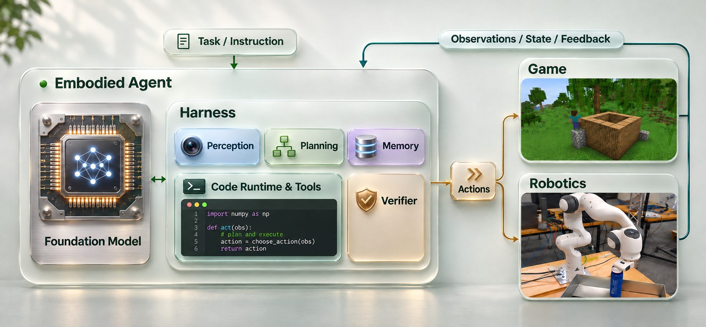

<h1 align="center">Awesome Embodied Agents</h1>

  

  
  
  
  
  
  
  

This list collects research on **code agents and agent harnesses for embodied intelligence in games and robotics**, including custom code-generation frameworks and general-purpose coding agents. It covers **surveys, harness design, model training and post-training, and benchmarks**, from code execution and tool use to planning, memory, feedback, and self-improvement. The collection also includes native LLM/VLM game and robot agents, with tasks spanning video games, interactive fiction, strategic board/card games, manipulation, navigation, and control. Within each category, papers are sorted by first release month (Arxiv v1), newest first, then alphabetically by title.

## Table of Contents

- [Survey](#survey)
- [Harness](#harness)
- [Model Training](#model-training)
- [Benchmark](#benchmark)
- [Contributing](#contributing)
- [License](#license)

## Survey

System-level surveys, perspectives, and roadmaps on agents in games and robotics. These references connect foundation models, training, data, environments, harnesses, and evaluation, alongside focused reviews of code-based skills.

| Paper | Venue | Task | Links |
| :--- | :---: | :--- | :--- |
| **[Envisioning Agentic Robotics: A New Era of Robotic Systems](https://arxiv.org/abs/2611.18359)** | Arxiv 2026-11 | Agentic robotics; Manipulation; Navigation | — |
| **[A Survey of Agentic Robotics: Toward Continual Self-Improvement](https://www.alphaxiv.org/abs/2610.rsi-agentic-robotics)** | alphaXiv Released 2026-10 | Robot task orchestration; Motion generation; Continual self-improvement | [🌐&nbsp;Project&nbsp;Page](https://github.com/jiaming-ai/awesome-agentic-robotics) |
| **[Multimodal Embodied Agents: A Unified Capability-centric Perspective from Computer-Use to Robot-Use](https://arxiv.org/abs/2610.30108)** | Arxiv 2026-10 | Computer use; Robot use; Embodied capability evaluation | [🌐&nbsp;Project&nbsp;Page](https://showlab.github.io/Awesome-Multimodal-Embodied-Agent/) |
| **[Towards Agentic Robots: Model, Data, Environment, and Harness](https://arxiv.org/abs/2610.20442)** | Arxiv 2026-10 | Agentic robotics; Manipulation; Navigation | [🌐&nbsp;Project&nbsp;Page](https://github.com/chonghanqin/Awesome-Agentic-Robots) |
| **[Who Improves the Robot? Toward Physical Recursive Self-Improvement](https://arxiv.org/abs/2610.18842)** | Arxiv 2026-10 | Robot skill adaptation; Physical recursive self-improvement; Verification | [🌐&nbsp;Project&nbsp;Page](https://github.com/SAIL-Research-Lab/Physical-RSI) |
| **[Embodied Agentic Harnesses for Physical Intelligence: A Survey](https://doi.org/10.31224/8297)** | engrXiv Released 2026-09 | Embodied execution; Runtime monitoring; Recovery | [🌐&nbsp;Project&nbsp;Page](https://github.com/yuhuang-ca/Survey-of-Embodied-Agentic-Harness) |
| **[From Language Models to World-Acting Systems: Progress and Limits of Agentic AI across Digital, Social, Virtual, and Physical Environments](https://arxiv.org/abs/2609.04894)** | Arxiv 2026-09 | Virtual environments; Robot control; Delegation and recovery | — |
| **[Weights or Skills? A Survey of Robot-Learning Techniques: from Action-Predicting Weights to Robots that Write their Own Skills](https://arxiv.org/abs/2608.01851)** | Arxiv 2026-08 | Robot learning; Code-based skill acquisition | — |
| **[From World Action Models to Embodied Brains: A Roadmap for Open-World Physical Intelligence](https://arxiv.org/abs/2607.11689)** | Arxiv 2026-07 | Open-world robot control; Action consequence prediction; Closed-loop learning | — |
| **[Harness Engineering for Physical AI: Robot Middleware Is the Harness Layer](https://arxiv.org/abs/2606.09416)** | ACM Middleware 2026 Arxiv 2026-06 | Robot control; Real-time scheduling; Middleware | — |
| **[Towards Generalist Game Agents: A Survey of Foundation Models in Virtual Worlds](https://arxiv.org/abs/2605.09965)** | Arxiv 2026-05 | Game agents; Virtual worlds; Cross-game generalization | [🌐&nbsp;Project&nbsp;Page](https://thusi-lab.github.io/Awesome-LFMs-Play-Games/) |

## Harness

Frameworks that connect models or coding agents to games and robots through code execution, tool or skill calls, action interfaces, feedback, memory, and experiment orchestration. This includes harnesses around frozen VLAs, navigation agents, and code-driven training of downstream robot policies. See the [harness guide](docs/HARNESS_GUIDE.md) for interface distinctions and the search basis.

| Paper | Venue | Task | Links |
| :--- | :---: | :--- | :--- |
| **[Democratizing Robot-Use Agents: A Unified Harness with Open Models](https://arxiv.org/abs/2611.01560)** (uni-robot-agent) | Arxiv 2026-11 | Manipulation; Bimanual manipulation | [🌐&nbsp;Project&nbsp;Page](https://openrua.ai/uni-robot-agent) |
| **[Reins: Frontier Multimodal Models Driving Real Robot Arms on Long-Horizon Tasks, Zero-Shot](https://arxiv.org/abs/2611.16632)** | Arxiv 2026-11 | Manipulation; Bimanual manipulation | — |
| **[A team of Gemini 4 Argon agents beats Minecraft](https://arxiv.org/abs/2610.22319)** | Arxiv 2026-10 | Minecraft | — |
| **[Auriga Technical Report: A Task-Agnostic Agent Harness for Zero-Shot Embodied Manipulation](https://arxiv.org/abs/2611.01112)** | Arxiv 2026-10 | Manipulation; Bimanual manipulation | [💻&nbsp;Code](https://github.com/lose4578/Auriga) [🌐&nbsp;Project&nbsp;Page](https://auriga.stelledge.com/) |
| **[Embodied Turing Machines: Stateful Code for Robot Recursive Self-Improvement](https://arxiv.org/abs/2610.12369)** (COAP) | Arxiv 2026-10 | Bimanual manipulation | — |
| **[EMHO: EMbodied Agent Harness Optimization via Experience Traces](https://arxiv.org/abs/2610.08432)** | Arxiv 2026-10 | Navigation; Manipulation | — |
| **[Fewer Tokens, Better Action: GPT-6 Astra Robot Agents with 14% Higher Success Rate but 65% Fewer Tokens](https://arxiv.org/abs/2610.01939)** (PyRUA-Lean) | CoRL Workshop 2026 Arxiv 2026-10 | Manipulation; Bimanual manipulation | [💻&nbsp;Code](https://github.com/DAGroup-PKU/PyRUA-Lean) [🌐&nbsp;Project&nbsp;Page](https://dagroup-pku.github.io/PyRUA-Lean/docs/) |
| **[HexaShell: A Universal Harness for Robot Coding Agents in Simulation and the Real World](https://arxiv.org/abs/2610.23479)** | Arxiv 2026-10 | Manipulation; Bimanual manipulation | [💻&nbsp;Code](https://github.com/HexaFuture/HexaShell) |
| **[HiSTEVE 1.0: Harnessing Human-Interface VLA Agents for Open-World Games](https://arxiv.org/abs/2610.31162)** | Arxiv 2026-10 | Minecraft | [💻&nbsp;Code](https://github.com/Andytonglove/HiSTEVE-1.0) |
| **[KPHarness: Co-Evolving Knowledge and Probing for Long-Horizon Gaming Harnesses](https://arxiv.org/abs/2610.27417)** | Arxiv 2026-10 | Minecraft | [🌐&nbsp;Project&nbsp;Page](https://chenzk202212.github.io/adaptive-gaming-harnesses/) |
| **[OpenRUA: Robot-Use Agents Are Zero-Shot Visuomotor Policies](https://arxiv.org/abs/2610.02459)** | Arxiv 2026-10 | Manipulation; Mobile manipulation | [💻&nbsp;Code](https://github.com/terminalworld/OpenRUA) |
| **[RoboArchitect: Automating the Design of Robotic Agents with Persistent Memory](https://arxiv.org/abs/2610.42141)** | Arxiv 2026-10 | Manipulation | [💻&nbsp;Code](https://github.com/roboarchitect-ai/RoboArchitect) [🌐&nbsp;Project&nbsp;Page](https://roboarchitect-ai.github.io/) |
| **[Scaling Online Exploration for Robot Agents](https://arxiv.org/abs/2610.22496)** (RAX) | Arxiv 2026-10 | Manipulation; Mobile manipulation; Dexterous manipulation | [💻&nbsp;Code](https://github.com/robot-agent-exploration/rax) |
| **[SuperNav: An Agentic Navigation System for Any Task in Any Scene](https://arxiv.org/abs/2610.12126)** | Arxiv 2026-10 | Navigation; Object-goal navigation; Multi-object navigation | [💻&nbsp;Code](https://github.com/zju3dv/SuperNav) [🌐&nbsp;Project&nbsp;Page](https://zju3dv.github.io/SuperNav/) |
| **[Agent as Policy for Robotic Manipulation](https://arxiv.org/abs/2609.12541)** | Arxiv 2026-09 | Manipulation; Assembly; Throwing; Cloth folding | [💻&nbsp;Code](https://github.com/agent-as-policy-2026/agent-as-policy) [🌐&nbsp;Project&nbsp;Page](https://agent-as-policy-2026.github.io/) |
| **[Coding Agents with Harness for Safe Robot Control](https://arxiv.org/abs/2609.20822)** (SafeHarness) | Arxiv 2026-09 | Manipulation; Obstacle avoidance | — |
| **[HarnessVLN: Unifying Training-Free Embodied Navigation through an Agent Harness](https://arxiv.org/abs/2609.15195)** | Arxiv 2026-09 | Navigation; Instruction following; Object-goal navigation | [💻&nbsp;Code](https://github.com/AgibotGeneral/harnessvln) [🌐&nbsp;Project&nbsp;Page](https://agibot-harnessvln.netlify.app/) |
| **[RACaP: Agentic Reasoning, Acting, and Coding as Policies for Evolvable Robot Learning](https://arxiv.org/abs/2609.29394)** | Arxiv 2026-09 | Manipulation | [💻&nbsp;Code](https://github.com/Robo-Harness/racap) |
| **[RegenHarness: A Robot Agent Harness with Evidence-Gated Recursive Self-Improvement](https://arxiv.org/abs/2609.27612)** | Arxiv 2026-09 | Navigation; Inspection; Message delivery | — |
| **[Robo-Harness K1: Harnessing Robot-Use Agents via Perception Augmentation](https://arxiv.org/abs/2609.29389)** | Arxiv 2026-09 | Manipulation; Bimanual manipulation | [💻&nbsp;Code](https://github.com/Robo-Harness/k1) [🌐&nbsp;Project&nbsp;Page](https://robo-harness.github.io/k1/) |
| **[RoboHarness: A Simple Harness Outperforms VLA and World Action Models](https://arxiv.org/abs/2610.14018)** | Arxiv 2026-09 | Household tasks; Manipulation | [💻&nbsp;Code](https://github.com/BinceQu/RoboHarness) |
| **[Show-Harness: Just a VLM Agent Can Play Robots](https://arxiv.org/abs/2609.10522)** | Arxiv 2026-09 | Manipulation; Bimanual manipulation | [💻&nbsp;Code](https://github.com/showlab/Show-Harness) [🌐&nbsp;Project&nbsp;Page](https://showlab.github.io/Show-Harness/) |
| **[Transferring the Intelligence of VLMs to Robotic Control](https://arxiv.org/abs/2609.22966)** (RoboDawn) | Arxiv 2026-09 | Manipulation; Bimanual manipulation | — |
| **[Harness VLA: Steering Frozen VLAs into Reliable Manipulation Primitives via Memory-Guided Agents](https://arxiv.org/abs/2607.08448)** | Arxiv 2026-07 | Manipulation; Household tasks; Bimanual manipulation | [💻&nbsp;Code](https://github.com/RLinf/RPent) [🌐&nbsp;Project&nbsp;Page](https://harnessvla.github.io/) |
| **[ASPIRE: Agentic /Skills Discovery for Robotics](https://arxiv.org/abs/2607.00272)** | Arxiv 2026-06 | Manipulation; Bimanual handover; Household tasks | [💻&nbsp;Code](https://github.com/NVlabs/ASPIRE) |
| **[ENPIRE: Agentic Robot Policy Self-Improvement in the Real World](https://arxiv.org/abs/2606.19980)** | CoRL 2026 Arxiv 2026-06 | Manipulation; Assembly | [💻&nbsp;Code](https://github.com/NVlabs/ENPIRE) [🌐&nbsp;Project&nbsp;Page](https://research.nvidia.com/labs/gear/enpire/) |
| **[Playful Agentic Robot Learning](https://arxiv.org/abs/2606.19419)** | CoRL 2026 Arxiv 2026-06 | Manipulation; Skill acquisition | [💻&nbsp;Code](https://github.com/Playful-RATs/rats) [🌐&nbsp;Project&nbsp;Page](https://playful-rats.github.io/) |
| **[RHO: Your Coding Agent is Secretly a Roboticist](https://arxiv.org/abs/2606.16458)** | Arxiv 2026-06 | Manipulation | [🌐&nbsp;Project&nbsp;Page](https://rho-robotics.github.io/) |
| **[APEX: Autonomous Policy Exploration for Self-Evolving LLM Agents](https://arxiv.org/abs/2605.21240)** | Arxiv 2026-05 | Jericho text adventures | [💻&nbsp;Code](https://github.com/liushiliushi/APEX1) |
| **[Continual Harness: Online Adaptation for Self-Improving Foundation Agents](https://arxiv.org/abs/2605.09998)** | Arxiv 2026-05 | Pokémon Red; Pokémon Emerald | [💻&nbsp;Code](https://github.com/sethkarten/continual-harness) [🌐&nbsp;Project&nbsp;Page](https://sethkarten.ai/continual-harness/) |
| **[SPIKE: An Adaptive Dual Controller Framework for Cost-Efficient Long-Horizon Game Agents](https://arxiv.org/abs/2605.18636)** | Arxiv 2026-05 | Stardew Valley | [💻&nbsp;Code](https://github.com/wencanjiang/SPIKE) [🌐&nbsp;Project&nbsp;Page](https://wencanjiang.github.io/projects/SPIKE/) |
| **[RoboClaw: An Agentic Framework for Scalable Long-Horizon Robotic Tasks](https://arxiv.org/abs/2603.11558)** | Arxiv 2026-03 | Manipulation | [💻&nbsp;Code](https://github.com/RoboClaw-Robotics/RoboClaw) [🌐&nbsp;Project&nbsp;Page](https://roboclaw-agibot.github.io/) |
| **[Code Evolution for Control: Synthesizing Policies via LLM-Driven Evolutionary Search](https://arxiv.org/abs/2601.06845)** (EvoControl) | Arxiv 2026-01 | LunarLander | [💻&nbsp;Code](https://github.com/pgg3/EvoControl) |
| **[Real-Time Reasoning Agents in Evolving Environments](https://arxiv.org/abs/2511.04898)** (AgileThinker) | Arxiv 2025-11 | Freeway; Snake; Overcooked | [💻&nbsp;Code](https://github.com/SALT-NLP/RealtimeGym) |
| **[Code World Models for General Game Playing](https://arxiv.org/abs/2510.04542)** (CWM) | ICLR 2026 Arxiv 2025-10 | Tic-Tac-Toe; Chess variants; Card games | — |
| **[VistaWise: Building Cost-Effective Agent with Cross-Modal Knowledge Graph for Minecraft](https://arxiv.org/abs/2508.18722)** | EMNLP 2025 Arxiv 2025-08 | Minecraft | — |
| **[General Modular Harness for LLM Agents in Multi-Turn Gaming Environments](https://arxiv.org/abs/2507.11633)** (GMH) | ICML Workshop 2025 Arxiv 2025-07 | Puzzle games; Arcade games | — |
| **[Learning to Play Like Humans: A Framework for LLM Adaptation in Interactive Fiction Games](https://arxiv.org/abs/2505.12439)** (LPLH) | Findings of ACL 2025 Arxiv 2025-05 | Interactive fiction; Narrative exploration | — |
| **[Cultivating Gaming Sense for Yourself: Making VLMs Gaming Experts](https://arxiv.org/abs/2503.21263)** (GameSense) | ACL 2025 Arxiv 2025-03 | Flappy Bird; First-person shooters; Action-role-playing combat | [💻&nbsp;Code](https://github.com/ipsss2/GameSense) |
| **[Reflection of Episodes: Learning to Play Game from Expert and Self Experiences](https://arxiv.org/abs/2502.13388)** (ROE) | Arxiv 2025-02 | StarCraft II | — |
| **[Code-as-Monitor: Constraint-aware Visual Programming for Reactive and Proactive Robotic Failure Detection](https://arxiv.org/abs/2412.04455)** | CVPR 2025 Arxiv 2024-12 | Manipulation; Failure detection | [🌐&nbsp;Project&nbsp;Page](https://zhoues.github.io/Code-as-Monitor/) |
| **[Can VLMs Play Action Role-Playing Games? Take Black Myth Wukong as a Study Case](https://arxiv.org/abs/2409.12889)** (VARP) | Arxiv 2024-09 | Black Myth: Wukong | [🌐&nbsp;Project&nbsp;Page](https://varp-agent.github.io/) |
| **[ReKep: Spatio-Temporal Reasoning of Relational Keypoint Constraints for Robotic Manipulation](https://arxiv.org/abs/2409.01652)** | CoRL 2024 Arxiv 2024-09 | Manipulation; Mobile manipulation; Bimanual manipulation | [💻&nbsp;Code](https://github.com/huangwl18/ReKep) [🌐&nbsp;Project&nbsp;Page](https://rekep-robot.github.io/) |
| **[Optimus-1: Hybrid Multimodal Memory Empowered Agents Excel in Long-Horizon Tasks](https://arxiv.org/abs/2408.03615)** | NeurIPS 2024 Arxiv 2024-08 | Minecraft | [💻&nbsp;Code](https://github.com/iLearn-Lab/NeurIPS24-Optimus-1) [🌐&nbsp;Project&nbsp;Page](https://cybertronagent.github.io/Optimus-1.github.io/) |
| **[DrEureka: Language Model Guided Sim-To-Real Transfer](https://arxiv.org/abs/2406.01967)** | RSS 2024 Arxiv 2024-06 | Locomotion; Dexterous manipulation | [💻&nbsp;Code](https://github.com/eureka-research/DrEureka) [🌐&nbsp;Project&nbsp;Page](https://eureka-research.github.io/dr-eureka/) |
| **[InstructNav: Zero-shot System for Generic Instruction Navigation in Unexplored Environment](https://arxiv.org/abs/2406.04882)** | CoRL 2024 Arxiv 2024-06 | Navigation; Instruction following; Object-goal navigation | [💻&nbsp;Code](https://github.com/LYX0501/InstructNav) |
| **[RoboCoder: Robotic Learning from Basic Skills to General Tasks with Large Language Models](https://arxiv.org/abs/2406.03757)** | Arxiv 2024-06 | Locomotion; Manipulation | — |
| **[Cradle: Empowering Foundation Agents Towards General Computer Control](https://arxiv.org/abs/2403.03186)** | Arxiv 2024-03 | Red Dead Redemption II; Stardew Valley; Cities: Skylines | [💻&nbsp;Code](https://github.com/BAAI-Agents/Cradle) [🌐&nbsp;Project&nbsp;Page](https://baai-agents.github.io/Cradle/) |
| **[Introspective Planning: Aligning Robots' Uncertainty with Inherent Task Ambiguity](https://arxiv.org/abs/2402.06529)** | NeurIPS 2024 Arxiv 2024-02 | Mobile manipulation; Instruction following | [💻&nbsp;Code](https://github.com/kevinliang888/IntroPlan) [🌐&nbsp;Project&nbsp;Page](https://introplan.github.io/) |
| **[RoboScript: Code Generation for Free-Form Manipulation Tasks across Real and Simulation](https://arxiv.org/abs/2402.14623)** | Arxiv 2024-02 | Manipulation; Object rearrangement | — |
| **[MapGPT: Map-Guided Prompting with Adaptive Path Planning for Vision-and-Language Navigation](https://arxiv.org/abs/2401.07314)** | ACL 2024 Arxiv 2024-01 | Navigation; Instruction following; Object grounding | [💻&nbsp;Code](https://github.com/chen-judge/MapGPT) [🌐&nbsp;Project&nbsp;Page](https://chen-judge.github.io/MapGPT/) |
| **[Distilling and Retrieving Generalizable Knowledge for Robot Manipulation via Language Corrections](https://arxiv.org/abs/2311.10678)** (DROC) | ICRA 2024 Arxiv 2023-11 | Manipulation; Instruction correction | [💻&nbsp;Code](https://github.com/Stanford-ILIAD/droc) [🌐&nbsp;Project&nbsp;Page](https://sites.google.com/stanford.edu/droc) |
| **[JARVIS-1: Open-World Multi-task Agents with Memory-Augmented Multimodal Language Models](https://arxiv.org/abs/2311.05997)** | TPAMI 2025 Arxiv 2023-11 | Minecraft | [💻&nbsp;Code](https://github.com/CraftJarvis/JARVIS-1) [🌐&nbsp;Project&nbsp;Page](https://craftjarvis-jarvis1.github.io/) |
| **[Creative Robot Tool Use with Large Language Models](https://arxiv.org/abs/2310.13065)** (RoboTool) | Arxiv 2023-10 | Manipulation; Physical tool use; Locomotion | [🌐&nbsp;Project&nbsp;Page](https://creative-robotool.github.io/) |
| **[Eureka: Human-Level Reward Design via Coding Large Language Models](https://arxiv.org/abs/2310.12931)** | ICLR 2024 Arxiv 2023-10 | Locomotion; Dexterous manipulation | [💻&nbsp;Code](https://github.com/eureka-research/Eureka) [🌐&nbsp;Project&nbsp;Page](https://eureka-research.github.io/) |
| **[Prompt a Robot to Walk with Large Language Models](https://arxiv.org/abs/2309.09969)** (Prompt2Walk) | CDC 2024 Arxiv 2023-09 | Locomotion | [💻&nbsp;Code](https://github.com/HybridRobotics/prompt2walk) [🌐&nbsp;Project&nbsp;Page](https://prompt2walk.github.io/) |
| **[DoReMi: Grounding Language Model by Detecting and Recovering from Plan-Execution Misalignment](https://arxiv.org/abs/2307.00329)** | IROS 2024 Arxiv 2023-07 | Manipulation; Locomotion | [🌐&nbsp;Project&nbsp;Page](https://sites.google.com/view/doremi-paper) |
| **[VoxPoser: Composable 3D Value Maps for Robotic Manipulation with Language Models](https://arxiv.org/abs/2307.05973)** | CoRL 2023 Arxiv 2023-07 | Manipulation | [💻&nbsp;Code](https://github.com/huangwl18/VoxPoser) [🌐&nbsp;Project&nbsp;Page](https://voxposer.github.io/) |
| **[REFLECT: Summarizing Robot Experiences for Failure Explanation and Correction](https://arxiv.org/abs/2306.15724)** | CoRL 2023 Arxiv 2023-06 | Manipulation; Failure diagnosis; Task recovery | [💻&nbsp;Code](https://github.com/real-stanford/reflect) [🌐&nbsp;Project&nbsp;Page](https://robot-reflect.github.io/) |
| **[Statler: State-Maintaining Language Models for Embodied Reasoning](https://arxiv.org/abs/2306.17840)** | ICRA 2024 Arxiv 2023-06 | Manipulation; Object rearrangement | [💻&nbsp;Code](https://github.com/ripl/statler) [🌐&nbsp;Project&nbsp;Page](https://statler-lm.github.io/) |
| **[Demo2Code: From Summarizing Demonstrations to Synthesizing Code via Extended Chain-of-Thought](https://arxiv.org/abs/2305.16744)** | NeurIPS 2023 Arxiv 2023-05 | Robotouille; Manipulation; Cooking tasks | [💻&nbsp;Code](https://github.com/portal-cornell/demo2code) [🌐&nbsp;Project&nbsp;Page](https://portal.cs.cornell.edu/demo2code/) |
| **[Ghost in the Minecraft: Generally Capable Agents for Open-World Environments via Large Language Models with Text-based Knowledge and Memory](https://arxiv.org/abs/2305.17144)** (GITM) | Arxiv 2023-05 | Minecraft | [💻&nbsp;Code](https://github.com/OpenGVLab/GITM) |
| **[Instruct2Act: Mapping Multi-modality Instructions to Robotic Actions with Large Language Model](https://arxiv.org/abs/2305.11176)** | Arxiv 2023-05 | Manipulation | [💻&nbsp;Code](https://github.com/OpenGVLab/Instruct2Act) |
| **[NavGPT: Explicit Reasoning in Vision-and-Language Navigation with Large Language Models](https://arxiv.org/abs/2305.16986)** | AAAI 2024 Arxiv 2023-05 | Navigation; Instruction following | [💻&nbsp;Code](https://github.com/GengzeZhou/NavGPT) |
| **[TidyBot: Personalized Robot Assistance with Large Language Models](https://arxiv.org/abs/2305.05658)** | IROS 2023 Arxiv 2023-05 | Mobile manipulation; Household cleanup; Object sorting | [🌐&nbsp;Project&nbsp;Page](https://tidybot.cs.princeton.edu/) |
| **[Voyager: An Open-Ended Embodied Agent with Large Language Models](https://arxiv.org/abs/2305.16291)** | Arxiv 2023-05 | Minecraft | [💻&nbsp;Code](https://github.com/MineDojo/Voyager) [🌐&nbsp;Project&nbsp;Page](https://voyager.minedojo.org/) |
| **[Text2Motion: From Natural Language Instructions to Feasible Plans](https://arxiv.org/abs/2303.12153)** | Autonomous Robots 2023 Arxiv 2023-03 | Manipulation; Object rearrangement | [🌐&nbsp;Project&nbsp;Page](https://sites.google.com/stanford.edu/text2motion) |
| **[ChatGPT for Robotics: Design Principles and Model Abilities](https://arxiv.org/abs/2306.17582)** | IEEE Access 2024 Arxiv 2023-02 | Manipulation; Navigation; Aerial control | [💻&nbsp;Code](https://github.com/microsoft/PromptCraft-Robotics) [🌐&nbsp;Project&nbsp;Page](https://www.microsoft.com/en-us/research/articles/chatgpt-for-robotics/) |
| **[Describe, Explain, Plan and Select: Interactive Planning with Large Language Models Enables Open-World Multi-Task Agents](https://arxiv.org/abs/2302.01560)** (DEPS) | NeurIPS 2023 Arxiv 2023-02 | Minecraft | [💻&nbsp;Code](https://github.com/CraftJarvis/MC-Planner) |
| **[Code as Policies: Language Model Programs for Embodied Control](https://arxiv.org/abs/2209.07753)** | Arxiv 2022-09 | Manipulation | [💻&nbsp;Code](https://github.com/google-research/google-research/tree/master/code_as_policies) [🌐&nbsp;Project&nbsp;Page](https://code-as-policies.github.io/) |
| **[ProgPrompt: Generating Situated Robot Task Plans using Large Language Models](https://arxiv.org/abs/2209.11302)** | ICRA 2023 Arxiv 2022-09 | Household tasks; Manipulation | [💻&nbsp;Code](https://github.com/NVlabs/progprompt-vh) [🌐&nbsp;Project&nbsp;Page](https://progprompt.github.io/) |
| **[Inner Monologue: Embodied Reasoning through Planning with Language Models](https://arxiv.org/abs/2207.05608)** | CoRL 2022 Arxiv 2022-07 | Manipulation; Mobile manipulation; Household tasks | [🌐&nbsp;Project&nbsp;Page](https://innermonologue.github.io/) |

## Model Training

| Paper | Venue | Task | Links |
| :--- | :---: | :--- | :--- |
| **[Training Reasoning Models in Simulation to Natively Use Real Robots](https://arxiv.org/abs/2611.18562)** (PEAR) | Arxiv 2026-11 | Manipulation; Object pickup; Block alignment | [💻&nbsp;Code](https://github.com/mit-han-lab/pear) [🌐&nbsp;Project&nbsp;Page](https://mit-han-lab.github.io/pear-blog/) |
| **[AgenticRoboRL: Bringing Coding-Agent Post-Training to Agentic Robotics](https://arxiv.org/abs/2610.28589)** | Arxiv 2026-10 | Manipulation | [💻&nbsp;Code](https://github.com/xinxinliu-ai/AgenticRoboRL) [🌐&nbsp;Project&nbsp;Page](https://xinxinliu-ai.github.io/AgenticRoboRL/) |
| **[CaPtain: A Pipeline for Post-Training Code-as-Policy Robot Agents](https://arxiv.org/abs/2610.40799)** | Arxiv 2026-10 | Manipulation; Object rearrangement | [💻&nbsp;Code](https://github.com/waltstephen/CaPtain) [🌐&nbsp;Project&nbsp;Page](https://waltstephen.github.io/captain/) |
| **[Player-1: Learning to Play from Synthetic Experience](https://arxiv.org/abs/2610.20584)** | Arxiv 2026-10 | Minecraft; ViZDoom; Synthetic 2D/3D games | [🌐&nbsp;Project&nbsp;Page](https://player-1-project.github.io/) |
| **[Pretraining Knows What, Simulation Teaches How: Compositional Generalization for Agentic Robotics](https://arxiv.org/abs/2610.35817)** (ZAP) | CoRL LBR 2026 Arxiv 2026-10 | Manipulation; Bimanual manipulation | [🌐&nbsp;Project&nbsp;Page](https://zero-real.github.io/) |
| **[Guava: Distilling Frontier VLMs into a Compact Agent through a Robotic Manipulation Harness](https://arxiv.org/abs/2606.18363)** | CoRL Workshop 2026 Arxiv 2026-06 | Manipulation; Object rearrangement | [💻&nbsp;Code](https://github.com/hdacnw/guava-release) [🌐&nbsp;Project&nbsp;Page](https://guava-harness.github.io/) |
| **[Odysseus: Scaling VLMs to 100+ Turn Decision-Making in Games via Reinforcement Learning](https://arxiv.org/abs/2605.00347)** | COLM 2026 Arxiv 2026-05 | Super Mario Land; Super Mario Bros. | [💻&nbsp;Code](https://github.com/odysseus-project/odysseus-mario-training) [🌐&nbsp;Project&nbsp;Page](https://odysseus-project.github.io/) |
| **[RoboEvolve: Co-Evolving Planner-Simulator for Robotic Manipulation with Limited Data](https://arxiv.org/abs/2605.13775)** | Arxiv 2026-05 | Manipulation | — |
| **[VAM: Verbalized Action Masking for Controllable Exploration in RL Post-Training -- A Chess Case Study](https://arxiv.org/abs/2602.16833)** | Arxiv 2026-02 | Chess | — |
| **[GameTalk: Training LLMs for Strategic Conversation](https://arxiv.org/abs/2601.16276)** | Arxiv 2026-01 | Rock-Paper-Scissors; Bertrand competition; Bargaining games | — |
| **[SIMA 2: A Generalist Embodied Agent for Virtual Worlds](https://arxiv.org/abs/2512.04797)** | Arxiv 2025-12 | ASKA; Minecraft; Cross-game control | [🌐&nbsp;Project&nbsp;Page](https://deepmind.google/blog/sima-2-an-agent-that-plays-reasons-and-learns-with-you-in-virtual-3d-worlds/) |
| **[Training One Model to Master Cross-Level Agentic Actions via Reinforcement Learning](https://arxiv.org/abs/2512.09706)** (CrossHA) | CVPR 2026 Arxiv 2025-12 | Minecraft | [💻&nbsp;Code](https://github.com/CraftJarvis/OpenHA) [🌐&nbsp;Project&nbsp;Page](https://craftjarvis.github.io/CrossHA/) |
| **[Lumine: An Open Recipe for Building Generalist Agents in 3D Open Worlds](https://arxiv.org/abs/2511.08892)** | Arxiv 2025-11 | Genshin Impact; Wuthering Waves; Honkai: Star Rail | — |
| **[Game-TARS: Pretrained Foundation Models for Scalable Generalist Multimodal Game Agents](https://arxiv.org/abs/2510.23691)** | Arxiv 2025-10 | Minecraft; First-person shooters; Web 3D games | [🌐&nbsp;Project&nbsp;Page](https://seed-tars.com/game-tars/) |
| **[MARSHAL: Incentivizing Multi-Agent Reasoning via Self-Play with Strategic LLMs](https://arxiv.org/abs/2510.15414)** | ICLR 2026 Arxiv 2025-10 | Tic-Tac-Toe; Connect Four; Kuhn Poker; Leduc Hold'em | [💻&nbsp;Code](https://github.com/thu-nics/MARSHAL) |
| **[VAGEN: Reinforcing World Model Reasoning for Multi-Turn VLM Agents](https://arxiv.org/abs/2510.16907)** | NeurIPS 2025 Arxiv 2025-10 | Sokoban; FrozenLake; Navigation; Manipulation | [💻&nbsp;Code](https://github.com/mll-lab-nu/VAGEN) [🌐&nbsp;Project&nbsp;Page](https://vagen-ai.github.io/) |
| **[OpenHA: A Series of Open-Source Hierarchical Agentic Models in Minecraft](https://arxiv.org/abs/2509.13347)** | Arxiv 2025-09 | Minecraft | [💻&nbsp;Code](https://github.com/CraftJarvis/OpenHA) |
| **[Reinforced Language Models for Sequential Decision Making](https://arxiv.org/abs/2508.10839)** (MS-GRPO) | Arxiv 2025-08 | Snake; FrozenLake | — |
| **[Think in Games: Learning to Reason in Games via Reinforcement Learning with Large Language Models](https://arxiv.org/abs/2508.21365)** | Arxiv 2025-08 | Honor of Kings | — |
| **[G1: Bootstrapping Perception and Reasoning Abilities of Vision-Language Model via Reinforcement Learning](https://arxiv.org/abs/2505.13426)** | Arxiv 2025-05 | 2048; Shisen-Sho; Swap | [💻&nbsp;Code](https://github.com/chenllliang/G1) |
| **[CombatVLA: An Efficient Vision-Language-Action Model for Combat Tasks in 3D Action Role-Playing Games](https://arxiv.org/abs/2503.09527)** | ICCV 2025 Arxiv 2025-03 | Black Myth: Wukong; Sekiro | [💻&nbsp;Code](https://github.com/ChenVoid/CombatVLA) [🌐&nbsp;Project&nbsp;Page](https://combatvla.github.io/) |
| **[JARVIS-VLA: Post-Training Large-Scale Vision Language Models to Play Visual Games with Keyboards and Mouse](https://arxiv.org/abs/2503.16365)** | Findings of ACL 2025 Arxiv 2025-03 | Minecraft | [💻&nbsp;Code](https://github.com/CraftJarvis/JarvisVLA) [🌐&nbsp;Project&nbsp;Page](https://craftjarvis.github.io/JarvisVLA/) |
| **[Learning Strategic Language Agents in the Werewolf Game with Iterative Latent Space Policy Optimization](https://arxiv.org/abs/2502.04686)** (LSPO) | ICML 2025 Arxiv 2025-02 | Werewolf | — |
| **[Robotic Programmer: Video Instructed Policy Code Generation for Robotic Manipulation](https://arxiv.org/abs/2501.04268)** (RoboPro) | Arxiv 2025-01 | Manipulation | [🌐&nbsp;Project&nbsp;Page](https://ustcwhy.github.io/publications/robopro/) |
| **[AHA: A Vision-Language-Model for Detecting and Reasoning Over Failures in Robotic Manipulation](https://arxiv.org/abs/2410.00371)** | ICLR 2025 Arxiv 2024-10 | Manipulation; Failure detection; Failure diagnosis | [💻&nbsp;Code](https://github.com/NVlabs/AHA) [🌐&nbsp;Project&nbsp;Page](https://aha-vlm.github.io/) |
| **[OmniJARVIS: Unified Vision-Language-Action Tokenization Enables Open-World Instruction Following Agents](https://arxiv.org/abs/2407.00114)** | NeurIPS 2024 Arxiv 2024-06 | Minecraft | [💻&nbsp;Code](https://github.com/CraftJarvis/OmniJARVIS) [🌐&nbsp;Project&nbsp;Page](https://omnijarvis.github.io/) |
| **[RoboCodeX: Multimodal Code Generation for Robotic Behavior Synthesis](https://arxiv.org/abs/2402.16117)** | ICML 2024 Arxiv 2024-02 | Manipulation; Navigation | — |
| **[LLaMA-Rider: Spurring Large Language Models to Explore the Open World](https://arxiv.org/abs/2310.08922)** | Findings of NAACL 2024 Arxiv 2023-10 | Minecraft | [💻&nbsp;Code](https://github.com/PKU-RL/LLaMA-Rider) |

## Benchmark

Benchmarks for code agents and for the broader abilities needed by agentic embodied systems, including tool use, planning, memory, exploration, and robot control. Some directly test executable programs; others provide complementary agent-level evaluation under action or skill interfaces.

The selection draws on the robotics and game-agent surveys above. See the [benchmark guide](docs/BENCHMARK_GUIDE.md) and [game-agent guide](docs/GAME_AGENT_GUIDE.md) for interfaces, source checks, and the distinction between offline diagnostics and closed-loop execution.

| Paper | Venue | Task | Links |
| :--- | :---: | :--- | :--- |
| **[Embodied First Exam](https://arxiv.org/abs/2611.12177)** | Arxiv 2026-11 | Spatial puzzles; Dexterous manipulation; Multi-robot interaction; Dynamic whole-body control; Sim-to-sim engineering | [💻&nbsp;Code](https://github.com/mll-lab-nu/embodied-first-exam) [🌐&nbsp;Project&nbsp;Page](https://www.embodied-first-exam.ai/) |
| **[Are Frontier VLM Agents Ready to Be Robot Generalists? An Empirical Study with the Embodied Agent Arena](https://arxiv.org/abs/2610.00854)** | Arxiv 2026-10 | Geometry; Spatial reasoning; Affordance; Planning; Manipulation | [💻&nbsp;Code](https://github.com/embodied-agent-arena/embodied-agent-arena) [🌐&nbsp;Project&nbsp;Page](https://embodied-agent-arena.github.io/embodied-agent-arena/) |
| **[Can AI Agents Learn Their Way to the Top? Evaluating Heuristic Learning in a Long-Running Game Agent Competition](https://arxiv.org/abs/2610.12341)** (AAArena) | Arxiv 2026-10 | Adversarial games; Game-policy coding | [💻&nbsp;Code](https://github.com/THU-CST-SAST/AAArena) |
| **[Embodied Skill Bench: Benchmarking How Well Agents with Embodied Skills Perform on Physical Tasks](https://arxiv.org/abs/2610.16238)** | Arxiv 2026-10 | Manipulation; Skill reuse | [💻&nbsp;Code](https://github.com/HanZhi306/EmbodiedSkill-Bench) |
| **[RoboQuest: Generalist Physical Agents that Search, Inspect and Test](https://arxiv.org/abs/2610.10388)** | Arxiv 2026-10 | Mobile manipulation; Search; Inspection; Interactive testing | [💻&nbsp;Code](https://github.com/declare-lab/RoboQuest) [🌐&nbsp;Project&nbsp;Page](https://declare-lab.github.io/RoboQuest/) |
| **[RobotWorld: Benchmarking Multimodal Agents for Robot Use Across Diverse Tasks and Embodiments](https://arxiv.org/abs/2610.10409)** | Arxiv 2026-10 | Manipulation; Mobile manipulation; Locomotion; Driving; Aerial control | [💻&nbsp;Code](https://github.com/robotworldai/robotworld) [🌐&nbsp;Project&nbsp;Page](https://robotworldai.github.io/) |
| **[SpireBench: Evaluating Long-Horizon Strategic Play of Agentic Models with Slay the Spire](https://arxiv.org/abs/2610.12596)** | Arxiv 2026-10 | Slay the Spire | — |
| **[CodeActionBench: Evaluating Agentic Code-as-Policy for Embodied Manipulation](https://arxiv.org/abs/2609.33807)** | Arxiv 2026-09 | Manipulation | [💻&nbsp;Code](https://github.com/lyhkk/CodeActionBench) [🌐&nbsp;Project&nbsp;Page](https://codeactionbench.org/benchmark) |
| **[EmbodiedSWE: Coding Agents for Long Horizon Dexterous Robotics](https://arxiv.org/abs/2609.27308)** | Arxiv 2026-09 | Manipulation; Assembly; Locomotion and manipulation | [💻&nbsp;Code](https://github.com/EmbodiedSWE/EmbodiedSWE) [🌐&nbsp;Project&nbsp;Page](https://embodiedswe.github.io/) |
| **[GameHorizon Suite: Multi-Horizon Data and Evaluation in Gameplay](https://arxiv.org/abs/2609.25001)** | Arxiv 2026-09 | Minecraft; Multi-game video understanding | [🌐&nbsp;Project&nbsp;Page](https://gamehorizon-suite.github.io/) |
| **[AgenticSTS: A Bounded-Memory Testbed for Long-Horizon LLM Agents](https://arxiv.org/abs/2607.02255)** | Arxiv 2026-07 | Slay the Spire 2 | [💻&nbsp;Code](https://github.com/AlayaLab/AgenticSTS) [🌐&nbsp;Project&nbsp;Page](https://alayalab.github.io/AgenticSTS/) |
| **[Compiled Agency: Coding Agents as Game AI Researchers -- from a Roguelike to StarCraft II and Civilization](https://arxiv.org/abs/2609.18996)** (Gauntlet) | Arxiv 2026-07 | Roguelike; StarCraft II; Freeciv | — |
| **[RoboDojo: A Unified Sim-and-Real Benchmark for Comprehensive Evaluation of Generalist Robot Manipulation Policies](https://arxiv.org/abs/2607.04434)** | Arxiv 2026-07 | Manipulation; Long-horizon execution | [💻&nbsp;Code](https://github.com/RoboDojo-Benchmark/RoboDojo) [🌐&nbsp;Project&nbsp;Page](https://robodojo-benchmark.com/) |
| **[OmniGameArena: A Unified UE5 Benchmark for VLM Game Agents with Improvement Dynamics](https://arxiv.org/abs/2606.09826)** | Arxiv 2026-06 | UE5 games; Solo play; PvP; Cooperation | [💻&nbsp;Code](https://github.com/mxlin043/OmniGameArena) [🌐&nbsp;Project&nbsp;Page](https://mxlin043.github.io/OmniGameArena/) |
| **[PTCG-Bench: Can LLM Agents Master Pokémon Trading Card Game?](https://arxiv.org/abs/2605.29653)** | Findings of EMNLP 2026 Arxiv 2026-05 | Pokémon Trading Card Game | [💻&nbsp;Code](https://github.com/zjunet/PTCG-Bench) |
| **[GameWorld: Towards Standardized and Verifiable Evaluation of Multimodal Game Agents](https://arxiv.org/abs/2604.07429)** | Arxiv 2026-04 | Browser games; Puzzle games; Action games | [💻&nbsp;Code](https://github.com/gameworld-project/gameworld) |
| **[Mastering PokeGym: Graph-Guided Multimodal Evolution at Test Time](https://arxiv.org/abs/2604.08340)** | Arxiv 2026-04 | Pokémon Legends: Z-A | — |
| **[CaP-X: A Framework for Benchmarking and Improving Coding Agents for Robot Manipulation](https://arxiv.org/abs/2603.22435)** | Arxiv 2026-03 | Manipulation | [🌐&nbsp;Project&nbsp;Page](https://capgym.github.io/) |
| **[GameVerse: Can Vision-Language Models Learn from Video-based Reflection?](https://arxiv.org/abs/2603.06656)** | ICML 2026 Arxiv 2026-03 | Angry Birds; Plants vs. Zombies; Tic-Tac-Toe | [💻&nbsp;Code](https://github.com/THUSI-Lab/GameVerse) [🌐&nbsp;Project&nbsp;Page](https://gameverse-bench.github.io/) |
| **[RoboMME: Benchmarking and Understanding Memory for Robotic Generalist Policies](https://arxiv.org/abs/2603.04639)** | ICML 2026 Arxiv 2026-03 | Manipulation; Temporal, spatial, object, and procedural memory | [💻&nbsp;Code](https://github.com/RoboMME/robomme_benchmark) [🌐&nbsp;Project&nbsp;Page](https://robomme.github.io/) |
| **[The PokeAgent Challenge: Competitive and Long-Context Learning at Scale](https://arxiv.org/abs/2603.15563)** | NeurIPS Competition 2025 Arxiv 2026-03 | Pokémon battles; Pokémon RPG speedrunning | — |
| **[BotzoneBench: Scalable LLM Evaluation via Graded AI Anchors](https://arxiv.org/abs/2602.13214)** | Arxiv 2026-01 | Board games; Card games; Strategic decision-making | [💻&nbsp;Code](https://github.com/AMysteriousBeing/BotzoneBench) |
| **[FlashAdventure: A Benchmark for GUI Agents Solving Full Story Arcs in Diverse Adventure Games](https://arxiv.org/abs/2509.01052)** | EMNLP 2025 Arxiv 2025-09 | Flash adventure games; Story completion | [💻&nbsp;Code](https://github.com/ahnjaewoo/FlashAdventure) |
| **[StarDojo: Benchmarking Open-Ended Behaviors of Agentic Multimodal LLMs in Production-Living Simulations with Stardew Valley](https://arxiv.org/abs/2507.07445)** | ECCV 2026 Arxiv 2025-07 | Stardew Valley | [💻&nbsp;Code](https://github.com/StarDojo2025/stardojo) |
| **[TextQuests: How Good are LLMs at Text-Based Video Games?](https://arxiv.org/abs/2507.23701)** | Arxiv 2025-07 | Infocom text adventures | [💻&nbsp;Code](https://github.com/centerforaisafety/textquests) [🌐&nbsp;Project&nbsp;Page](https://textquests.ai/) |
| **[Orak: A Foundational Benchmark for Training and Evaluating LLM Agents on Diverse Video Games](https://arxiv.org/abs/2506.03610)** | ICLR 2026 Arxiv 2025-06 | StarCraft II; Street Fighter III; Stardew Valley; Slay the Spire | [💻&nbsp;Code](https://github.com/krafton-ai/Orak) |
| **[KORGym: A Dynamic Game Platform for LLM Reasoning Evaluation](https://arxiv.org/abs/2505.14552)** | NeurIPS 2025 Arxiv 2025-05 | Logic games; Visual puzzles; Strategic games | [💻&nbsp;Code](https://github.com/multimodal-art-projection/KORGym) |
| **[lmgame-Bench: How Good are LLMs at Playing Games?](https://arxiv.org/abs/2505.15146)** | ICLR 2026 Arxiv 2025-05 | Sokoban; Tetris; 2048; Candy Crush; Pokémon Red | [💻&nbsp;Code](https://github.com/lmgame-org/GamingAgent) |
| **[VideoGameBench: Can Vision-Language Models complete popular video games?](https://arxiv.org/abs/2505.18134)** | Arxiv 2025-05 | Retro video games; Navigation; Full-game completion | [💻&nbsp;Code](https://github.com/alexzhang13/videogamebench) |
| **[TextArena](https://arxiv.org/abs/2504.11442)** | Arxiv 2025-04 | Competitive text games; Negotiation; Social reasoning | [💻&nbsp;Code](https://github.com/TextArena/TextArena) [🌐&nbsp;Project&nbsp;Page](https://www.textarena.ai/) |
| **[EmbodiedBench: Comprehensive Benchmarking Multi-modal Large Language Models for Vision-Driven Embodied Agents](https://arxiv.org/abs/2502.09560)** | ICML 2025 Arxiv 2025-02 | Household tasks; Navigation; Manipulation | [💻&nbsp;Code](https://github.com/EmbodiedBench/EmbodiedBench) [🌐&nbsp;Project&nbsp;Page](https://embodiedbench.github.io/) |
| **[TeamCraft: A Benchmark for Multi-Modal Multi-Agent Systems in Minecraft](https://arxiv.org/abs/2412.05255)** | Arxiv 2024-12 | Minecraft; Multi-agent cooperation | [💻&nbsp;Code](https://github.com/teamcraft-bench/teamcraft) |
| **[BALROG: Benchmarking Agentic LLM and VLM Reasoning On Games](https://arxiv.org/abs/2411.13543)** | ICLR 2025 Arxiv 2024-11 | NetHack; MiniHack; Crafter; TextWorld; BabaIsAI; BabyAI | [💻&nbsp;Code](https://github.com/balrog-ai/BALROG) [🌐&nbsp;Project&nbsp;Page](https://balrogai.com/) |
| **[GameBench: Evaluating Strategic Reasoning Abilities of LLM Agents](https://arxiv.org/abs/2406.06613)** | Arxiv 2024-06 | Board games; Card games; Strategic decision-making | [💻&nbsp;Code](https://github.com/Joshuaclymer/GameBench) |
| **[CivRealm: A Learning and Reasoning Odyssey in Civilization for Decision-Making Agents](https://arxiv.org/abs/2401.10568)** | ICLR 2024 Arxiv 2024-01 | Freeciv; Civilization-style strategy | [💻&nbsp;Code](https://github.com/bigai-ai/civrealm) |
| **[Large Language Models Play StarCraft II: Benchmarks and A Chain of Summarization Approach](https://arxiv.org/abs/2312.11865)** | NeurIPS 2024 Arxiv 2023-12 | StarCraft II | — |
| **[SmartPlay: A Benchmark for LLMs as Intelligent Agents](https://arxiv.org/abs/2310.01557)** | ICLR 2024 Arxiv 2023-10 | Rock-Paper-Scissors; Tower of Hanoi; Minecraft | [💻&nbsp;Code](https://github.com/microsoft/SmartPlay) |

## Contributing

Follow [CONTRIBUTING.md](CONTRIBUTING.md), use the **Add a paper** issue form, or create a note from [notes/TEMPLATE.md](notes/TEMPLATE.md). All repository content uses English.

The catalogue is maintained directly in Markdown. See [docs/MAINTAINING.md](docs/MAINTAINING.md) for editing and publishing instructions.

## License

Original curation, notes, and artwork are available under the [MIT License](LICENSE). Linked papers, code, datasets, and other third-party materials retain their respective licenses.
