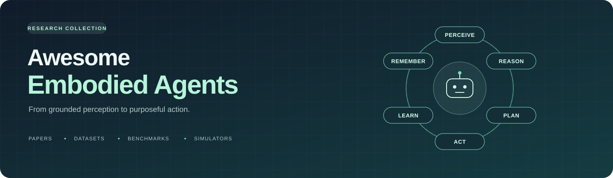

# Awesome Embodied Agents

  

  <strong>A curated collection of papers, datasets, benchmarks, and simulators for embodied agents.</strong> 
  具身智能体论文与资源索引 · 从感知和推理，到规划、行动与反馈学习

  <a href="#awesome-papers">Papers</a> ·
  <a href="#awesome-datasets">Datasets</a> ·
  <a href="#awesome-benchmarks">Benchmarks</a> ·
  <a href="#awesome-simulators">Simulators</a> ·
  <a href="notes/README.md">Reading Notes</a> ·
  <a href="CONTRIBUTING.md">贡献指南</a>

## About

This collection focuses on agents that perceive and act in physical or simulated spatial environments. It connects foundation models with grounded perception, reasoning, planning, memory, world modeling, and executable actions.

We cover both real robots and simulated embodied agents, with an emphasis on LLM/VLM-based systems and the methods that support their perception–action loop.

本仓库围绕具身智能体的完整交互闭环整理文献。论文按主要研究问题分类，数据集、评测基准和仿真器独立索引；详细边界见 [分类说明](docs/TAXONOMY.md)。

**Quick start:** browse the [reading guide](#reading-guide), add a paper using the [contribution guide](CONTRIBUTING.md), or create a note from the [reading template](notes/TEMPLATE.md).

## Highlights

- **Build a research map:** start with [Surveys](#surveys) and [Foundation Models and VLA](#foundation-models-and-vla).
- **Understand agent systems:** connect [Planning](#reasoning-planning-and-tool-use), [Memory](#memory-and-lifelong-learning), and [World Models](#world-models-and-prediction).
- **Study embodied tasks:** explore [Navigation](#navigation-and-exploration), [Manipulation](#manipulation-and-control), and [Multi-Agent Cooperation](#multi-agent-cooperation).
- **Find experimental resources:** browse [Datasets](#awesome-datasets), [Benchmarks](#awesome-benchmarks), and [Simulators](#awesome-simulators).

## Updates

- **2026-11-17:** Initialized the collection with a foundational reading selection, resource directories, contribution templates, and a reading-note workflow.

## Table of Contents

- [Awesome Papers](#awesome-papers)
  - [Surveys](#surveys)
  - [Foundation Models and VLA](#foundation-models-and-vla)
  - [Perception and Spatial Grounding](#perception-and-spatial-grounding)
  - [Reasoning, Planning and Tool Use](#reasoning-planning-and-tool-use)
  - [Memory and Lifelong Learning](#memory-and-lifelong-learning)
  - [World Models and Prediction](#world-models-and-prediction)
  - [Navigation and Exploration](#navigation-and-exploration)
  - [Manipulation and Control](#manipulation-and-control)
  - [Multi-Agent Cooperation](#multi-agent-cooperation)
  - [Evaluation and Reliability](#evaluation-and-reliability)
- [Awesome Datasets](#awesome-datasets)
- [Awesome Benchmarks](#awesome-benchmarks)
- [Awesome Simulators](#awesome-simulators)
- [Reading Guide](#reading-guide)
- [Related Collections](#related-collections)
- [Contributing](#contributing)
- [Acknowledgements](#acknowledgements)
- [License](#license)

## Awesome Papers

A starter selection of foundational and representative work. Within each category, papers are sorted by **first public release date, newest first**. `Date` is the first arXiv submission date for the entries below; `Venue` records a verified publication venue, with `arXiv` used when another venue has not been recorded here. `—` means a link has not been recorded.

Add each paper to one primary category. Cross-reference it from a reading note when it connects several topics. See [CONTRIBUTING.md](CONTRIBUTING.md) for the row template and metadata conventions.

### Surveys

综述与研究框架：建立领域地图、术语和技术分类。

| Title | Venue | Date | Code / List | Project |
| :--- | :---: | :---: | :---: | :---: |
| [**A Survey on Vision-Language-Action Models for Embodied AI**](https://arxiv.org/abs/2405.14093) | TNNLS 2026 | 2024-05-23 | [List](https://github.com/yueen-ma/Awesome-VLA) | — |

### Foundation Models and VLA

通用具身模型与视觉—语言—动作模型：多模态输入、动作表示与跨任务泛化。

| Title | Venue | Date | Code | Project |
| :--- | :---: | :---: | :---: | :---: |
| [**π₀: A Vision-Language-Action Flow Model for General Robot Control**](https://arxiv.org/abs/2410.24164) | arXiv | 2024-10-31 | [Code](https://github.com/Physical-Intelligence/openpi) | — |
| [**OpenVLA: An Open-Source Vision-Language-Action Model**](https://arxiv.org/abs/2406.09246) | arXiv | 2024-06-13 | [Code](https://github.com/openvla/openvla) | [Project](https://openvla.github.io/) |
| [**An Embodied Generalist Agent in 3D World (LEO)**](https://arxiv.org/abs/2311.12871) | ICML 2024 | 2023-11-18 | [Code](https://github.com/embodied-generalist/embodied-generalist) | [Project](https://embodied-generalist.github.io/) |
| [**RT-2: Vision-Language-Action Models Transfer Web Knowledge to Robotic Control**](https://arxiv.org/abs/2307.15818) | arXiv | 2023-07-28 | — | [Project](https://robotics-transformer2.github.io/) |
| [**PaLM-E: An Embodied Multimodal Language Model**](https://arxiv.org/abs/2303.03378) | arXiv | 2023-03-06 | — | [Project](https://palm-e.github.io/) |

### Perception and Spatial Grounding

环境感知与空间 grounding：开放词汇识别、3D 表征、场景图与语义地图。

| Title | Venue | Date | Code | Project |
| :--- | :---: | :---: | :---: | :---: |
| [**ConceptGraphs: Open-Vocabulary 3D Scene Graphs for Perception and Planning**](https://arxiv.org/abs/2309.16650) | ICRA 2024 | 2023-09-28 | [Code](https://github.com/concept-graphs/concept-graphs) | [Project](https://concept-graphs.github.io/) |

### Reasoning, Planning and Tool Use

任务推理与规划：任务分解、可供性约束、代码生成、技能调用与反馈重规划。

| Title | Venue | Date | Code | Project |
| :--- | :---: | :---: | :---: | :---: |
| [**Code as Policies: Language Model Programs for Embodied Control**](https://arxiv.org/abs/2209.07753) | arXiv | 2022-09-16 | [Code](https://github.com/google-research/google-research/tree/master/code_as_policies) | [Project](https://code-as-policies.github.io/) |
| [**Inner Monologue: Embodied Reasoning through Planning with Language Models**](https://arxiv.org/abs/2207.05608) | arXiv | 2022-07-12 | — | [Project](https://innermonologue.github.io/) |
| [**Do As I Can, Not As I Say: Grounding Language in Robotic Affordances (SayCan)**](https://arxiv.org/abs/2204.01691) | arXiv | 2022-04-04 | [Code](https://github.com/google-research/google-research/tree/master/saycan) | [Project](https://say-can.github.io/) |

### Memory and Lifelong Learning

记忆与持续学习：情景记忆、技能库、经验积累、技能迁移与自我改进。

| Title | Venue | Date | Code | Project |
| :--- | :---: | :---: | :---: | :---: |
| [**Voyager: An Open-Ended Embodied Agent with Large Language Models**](https://arxiv.org/abs/2305.16291) | arXiv | 2023-05-25 | [Code](https://github.com/MineDojo/Voyager) | [Project](https://voyager.minedojo.org/) |

### World Models and Prediction

世界模型与预测：动作条件预测、未来状态想象、模型辅助规划与生成式仿真。

| Title | Venue | Date | Code | Project |
| :--- | :---: | :---: | :---: | :---: |
| [**RoboDreamer: Learning Compositional World Models for Robot Imagination**](https://arxiv.org/abs/2404.12377) | ICML 2024 | 2024-04-18 | [Code](https://github.com/rainbow979/robodreamer) | [Project](https://robovideo.github.io/) |

### Navigation and Exploration

导航与探索：视觉语言导航、目标导航、主动探索和长程空间决策。

| Title | Venue | Date | Code | Project |
| :--- | :---: | :---: | :---: | :---: |
| [**NavGPT: Explicit Reasoning in Vision-and-Language Navigation with Large Language Models**](https://arxiv.org/abs/2305.16986) | AAAI 2024 | 2023-05-26 | [Code](https://github.com/GengzeZhou/NavGPT) | — |
| [**Visual Language Maps for Robot Navigation**](https://arxiv.org/abs/2210.05714) | ICRA 2023 | 2022-10-11 | [Code](https://github.com/vlmaps/vlmaps) | [Project](https://vlmaps.github.io/) |

### Manipulation and Control

机器人操控与控制：视觉运动策略、动作生成、轨迹优化与技能执行。

| Title | Venue | Date | Code | Project |
| :--- | :---: | :---: | :---: | :---: |
| [**VoxPoser: Composable 3D Value Maps for Robotic Manipulation with Language Models**](https://arxiv.org/abs/2307.05973) | CoRL 2023 | 2023-07-12 | [Code](https://github.com/huangwl18/VoxPoser) | [Project](https://voxposer.github.io/) |
| [**Diffusion Policy: Visuomotor Policy Learning via Action Diffusion**](https://arxiv.org/abs/2303.04137) | RSS 2023 / IJRR 2024 | 2023-03-07 | [Code](https://github.com/real-stanford/diffusion_policy) | [Project](https://diffusion-policy.cs.columbia.edu/) |

### Multi-Agent Cooperation

多具身智能体协作：通信、分工、共享环境中的协同规划与人机合作。

| Title | Venue | Date | Code | Project |
| :--- | :---: | :---: | :---: | :---: |
| [**Building Cooperative Embodied Agents Modularly with Large Language Models (CoELA)**](https://arxiv.org/abs/2307.02485) | ICLR 2024 | 2023-07-05 | [Code](https://github.com/UMass-Embodied-AGI/CoELA) | [Project](https://umass-embodied-agi.github.io/CoELA/) |

### Evaluation and Reliability

评测与可靠性：任务成功率、长程执行、泛化、失败诊断、鲁棒性与具身安全。

| Title | Venue | Date | Code | Project |
| :--- | :---: | :---: | :---: | :---: |
| [**EmbodiedBench: Comprehensive Benchmarking Multi-modal Large Language Models for Vision-Driven Embodied Agents**](https://arxiv.org/abs/2502.09560) | ICML 2025 | 2025-02-13 | [Code](https://github.com/EmbodiedBench/EmbodiedBench) | [Project](https://embodiedbench.github.io/) |

## Awesome Datasets

| Dataset | Focus | Official Resource |
| :--- | :--- | :--- |
| **Open X-Embodiment** | Cross-embodiment robot demonstrations | [Repository](https://github.com/google-deepmind/open_x_embodiment) |
| **DROID** | Diverse real-world robot manipulation data | [Project and Data](https://droid-dataset.github.io/) |

## Awesome Benchmarks

| Benchmark | Focus | Official Resource |
| :--- | :--- | :--- |
| **EmbodiedBench** | Vision-driven agent evaluation across embodied environments | [Repository](https://github.com/EmbodiedBench/EmbodiedBench) |
| **ALFRED** | Language-conditioned household task execution | [Repository](https://github.com/askforalfred/alfred) |
| **LIBERO** | Knowledge transfer and lifelong robot learning | [Repository](https://github.com/Lifelong-Robot-Learning/LIBERO) |
| **BEHAVIOR-1K** | Everyday activity evaluation and simulation resources | [Repository](https://github.com/StanfordVL/BEHAVIOR-1K) |

## Awesome Simulators

| Simulator / Platform | Focus | Official Resource |
| :--- | :--- | :--- |
| **Habitat-Lab** | Training and evaluating embodied agents | [Repository](https://github.com/facebookresearch/habitat-lab) |
| **AI2-THOR** | Interactive indoor environments | [Repository](https://github.com/allenai/ai2thor) |
| **ManiSkill** | Robot manipulation simulation and skill learning | [Repository](https://github.com/mani-skill/ManiSkill) |

## Reading Guide

| Step | Suggested Reading | Questions to Ask |
| :---: | :--- | :--- |
| 1 | [VLA Survey](https://arxiv.org/abs/2405.14093) → [PaLM-E](https://arxiv.org/abs/2303.03378) → [LEO](https://arxiv.org/abs/2311.12871) | What does the agent observe? How is its environment represented? |
| 2 | [SayCan](https://arxiv.org/abs/2204.01691) → [Inner Monologue](https://arxiv.org/abs/2207.05608) → [Code as Policies](https://arxiv.org/abs/2209.07753) | How are goals grounded, decomposed, executed, and revised? |
| 3 | [RT-2](https://arxiv.org/abs/2307.15818) → [OpenVLA](https://arxiv.org/abs/2406.09246) → [π₀](https://arxiv.org/abs/2410.24164) | What connects multimodal understanding with executable actions? |
| 4 | [Voyager](https://arxiv.org/abs/2305.16291) → [RoboDreamer](https://arxiv.org/abs/2404.12377) → [EmbodiedBench](https://arxiv.org/abs/2502.09560) | What improves with experience? How are prediction and task success evaluated? |

For each paper, record its **problem, observations, actions, agent loop, learning setup, evaluation, and limitations** using the [reading-note template](notes/TEMPLATE.md). Reading paths are editorial suggestions rather than a ranking.

## Related Collections

- [Awesome Embodied Robotics and Agent](https://github.com/zchoi/Awesome-Embodied-Robotics-and-Agent)
- [Awesome VLA](https://github.com/yueen-ma/Awesome-VLA)
- [LLM Agents Papers](https://github.com/zjunlp/LLMAgentPapers)
- [Awesome Multimodal Large Language Models](https://github.com/BradyFU/Awesome-Multimodal-Large-Language-Models)

## Contributing

Paper suggestions, resource additions, reading notes, and link corrections are welcome. Follow [CONTRIBUTING.md](CONTRIBUTING.md), submit a pull request, or use the **Add a paper** issue form.

日常维护只需编辑 Markdown：在相应分类插入论文表格行；精读内容放入 `notes/`。发布与维护步骤见 [中文维护指南](docs/MAINTAINING.md)。

## Acknowledgements

The presentation of this collection is inspired by [BradyFU/Awesome-Multimodal-Large-Language-Models](https://github.com/BradyFU/Awesome-Multimodal-Large-Language-Models), especially its topic-based paper tables and separate dataset directory. The taxonomy, descriptions, reading workflow, and banner in this repository are created for embodied-agent research.

## License

The original curation, notes, and artwork in this repository are available under the [MIT License](LICENSE). Linked papers, code, datasets, and other third-party materials retain their respective licenses.
